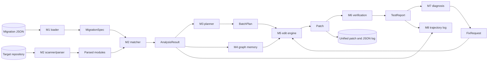
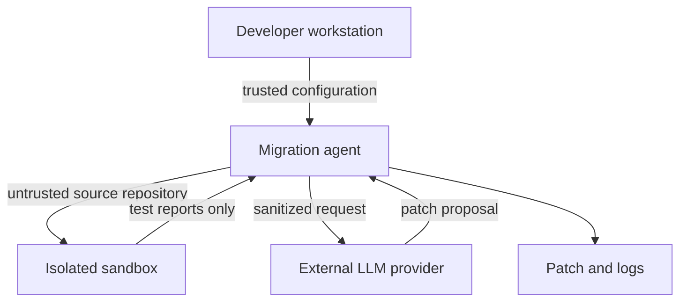

# Data Flow

## Overview

## Data stores and artifacts

| Artifact | Producer | Consumer | Sensitivity |
|---|---|---|---|
| Migration JSON | Developer | M1, M2, M5 | Project configuration |
| Parsed AST/module data | M2 | M2, M3, M4 | Source-derived |
| `AnalysisResult` | M2 | M3, M4, M5, M7 | Source-derived |
| `BatchPlan` | M3 | Agent loop | Operational |
| `Patch` | M5/M7 | Verification, M8 | May contain source code |
| `TestReport` | M6 | Agent, M7, M8 | Test output may contain paths |
| Graph memory | M4 | M5/M7 | Source metadata |
| Trajectory log | M8 | Developer/evaluation | Operational evidence |
| Benchmark metrics | M9 | Reports | Aggregate results |

## Trust boundaries

Untrusted repository code must run in the sandbox once M6 is available. Source
content sent to an external provider should be minimized and reviewed for
secrets before transmission.
