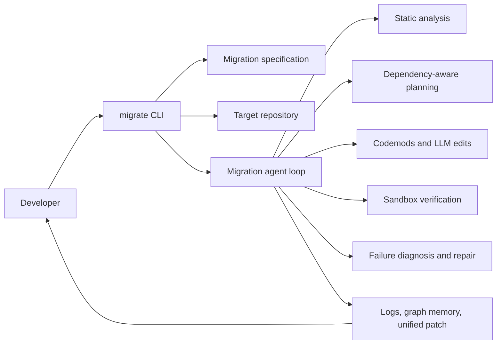

# High-Level Design

## Purpose

The migration agent upgrades a repository across a breaking library or
language change. Its primary target is SQLAlchemy 1.4 to 2.0. The agent first
maps affected call sites, builds a dependency-aware plan, applies deterministic
codemods before ambiguous edits, verifies each batch, and records the result.

## System context

## Module boundaries

| Module | Responsibility | Main location |
|---|---|---|
| M1 | Load and validate specifications; CLI configuration | `src/migration_agent/spec/`, `cli.py` |
| M2 | Scan, parse, resolve symbols, match deprecated APIs | `src/migration_agent/analysis/` |
| M3 | Order files and create dependency-safe batches | `src/migration_agent/planning/` |
| M4 | Track file state and graph relationships | `src/migration_agent/memory/` |
| M5 | Apply codemods and request ambiguous patches | `src/migration_agent/editing/` |
| M6 | Run lint/tests and manage repository checkpoints | `src/migration_agent/sandbox/` |
| M7 | Diagnose failures and prevent repair oscillation | `src/migration_agent/correction/` |
| M8 | Persist trajectory events and emit the final patch | `src/migration_agent/trajectory/` |
| M9 | Run corpus benchmarks and calculate metrics | `src/migration_agent/benchmark/` |

## Runtime stages

1. Load a migration specification and validate its fields.
2. Scan and parse Python source files.
3. Resolve imports, symbols, calls, and affected dependents.
4. Create batches in dependency order.
5. Apply deterministic codemods first.
6. Use an LLM only for ambiguous edits or repairs.
7. Verify each batch and roll back failed batches.
8. Write trajectory evidence and the final patch.

The repository currently contains working pieces of this design and explicit
stubs for modules still under development. The CLI exposes the intended
command surface, but a full `plan` or `run` requires the planner, memory,
sandbox, trajectory, and LLM modules to be completed.
