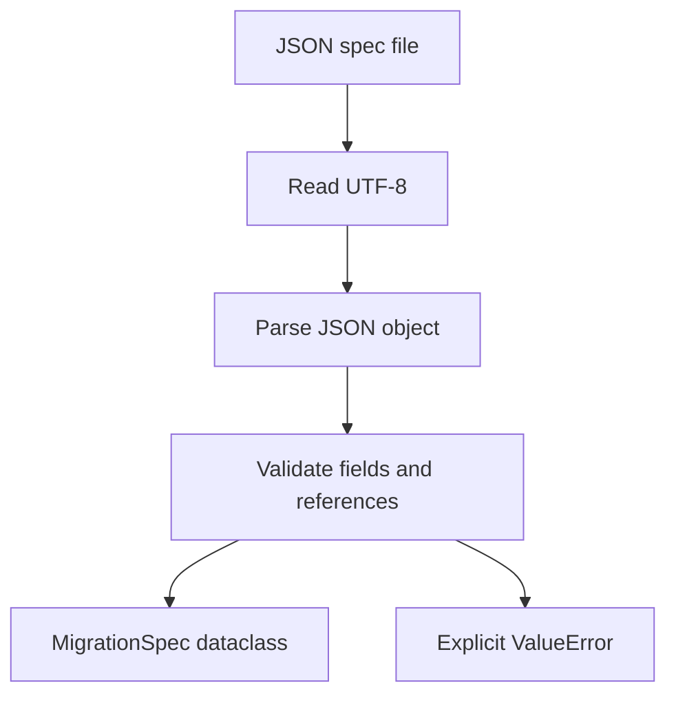
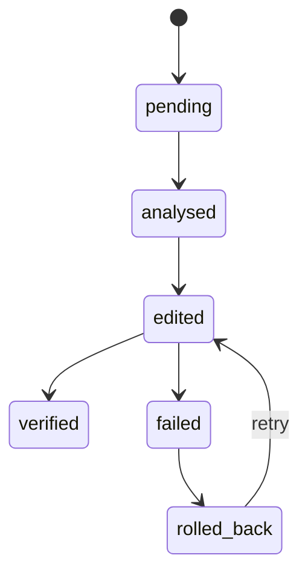

# Low-Level Design

## Shared contracts

The shared dataclasses in `src/migration_agent/models.py` are the contract
between modules. Important shapes include:

- `MigrationSpec`: migration identity, deprecated patterns, replacement rules,
  and oracle name.
- `RunConfig`: repository/spec paths and execution limits.
- `AnalysisResult`: import graph, call graph, call sites, impact set,
  unresolved sites, and parse failures.
- `BatchPlan`: ordered groups of files.
- `Patch`: one-file unified diff and its source strategy.
- `TestReport`: verification counts, failures, and green status.
- `LogEntry`: timestamped trajectory action and execution detail.

## Specification loading

M1 reads JSON, validates required strings, validates replacement strategies,
ensures rule pattern IDs refer to declared patterns, and returns typed
dataclasses. Invalid JSON, missing files, unknown fields, duplicate IDs, and
invalid values are reported explicitly.



## Static analysis

The analysis pipeline is intentionally separate from editing:

1. `RepositoryScanner` finds Python files and excludes tool directories.
2. `SourceParser` parses files and records parse failures.
3. `ImportGraphBuilder` resolves local import edges.
4. `SymbolTable` maps aliases and re-exports.
5. `CallSiteMatcher` identifies deprecated calls and unresolved dynamic cases.
6. `ImpactAnalyzer` and `CallGraphBuilder` identify affected dependents.
7. `OracleDetector` independently counts deprecated usage for completeness.

## Editing

Deterministic rules are registered by name in
`src/migration_agent/editing/codemods/`. The SQLAlchemy
`sqla_declarative_base` rule moves:

```python
from sqlalchemy.ext.declarative import declarative_base
```

to:

```python
from sqlalchemy.orm import declarative_base
```

It also rewrites module imports from `sqlalchemy.ext.declarative` to
`sqlalchemy.orm`. LibCST preserves formatting and comments. The edit engine
returns a unified diff and checks that the resulting file is valid Python.

## State transitions



## Configuration defaults

`RunConfig` supplies bounded defaults for token budget, steps, retries, batch
size, and impact depth. CLI overrides must be explicitly named and use the
expected type. Repository and specification paths must exist before a run.
