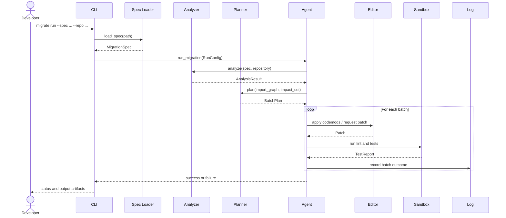
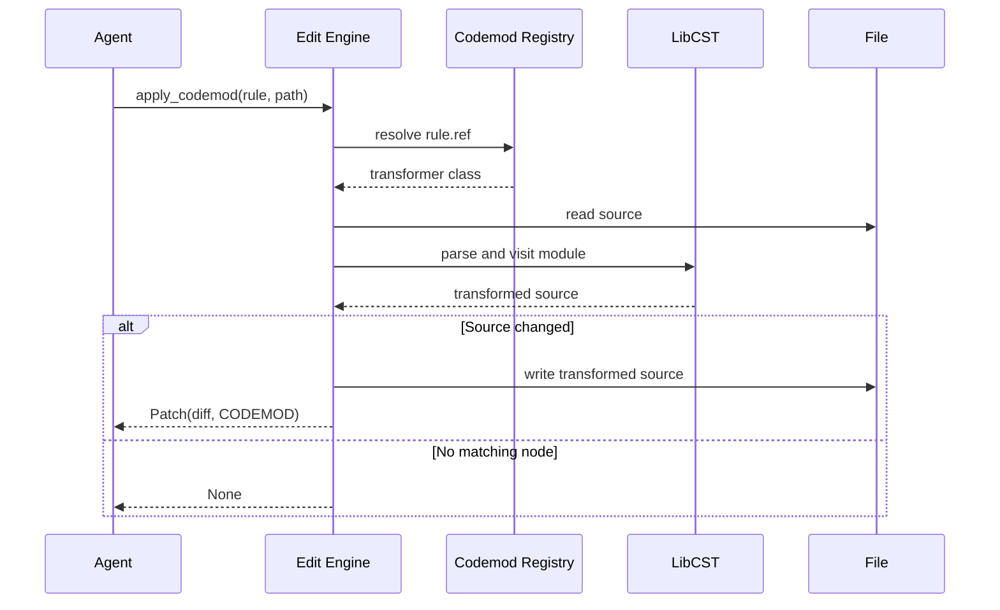
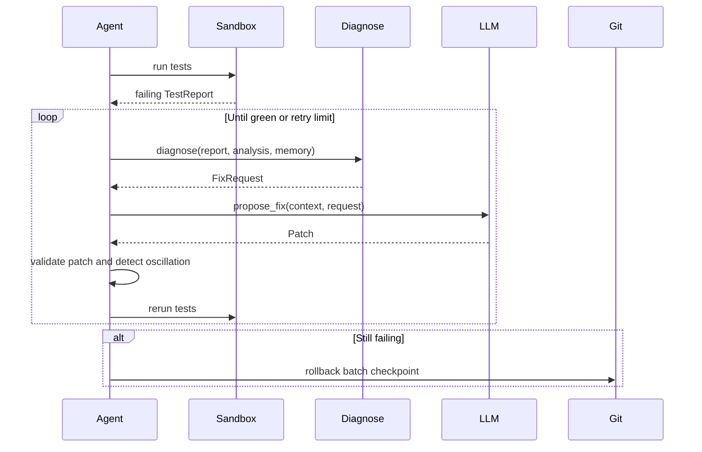

# Sequence Flows

## Planned end-to-end migration

## Deterministic codemod

## Failure repair loop

The repair and sandbox sequences describe the target architecture. Their
availability depends on the corresponding module implementations.
